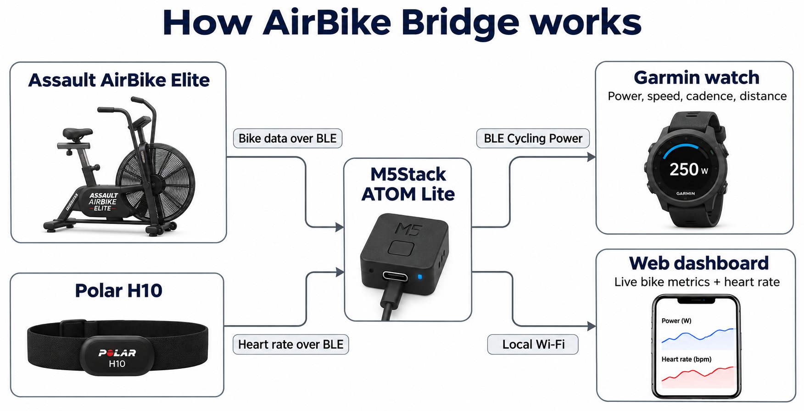
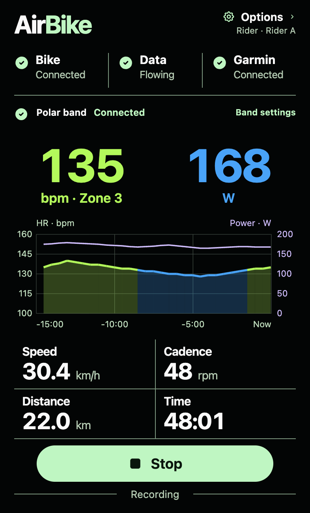

# AirBike Bridge

The Assault AirBike Elite sends workout data in its own Bluetooth format, so Garmin can’t record the bike’s readings directly. AirBike Bridge lets your watch log power, speed, cadence, and distance in a regular indoor ride. A small USB-powered device handles the connection on its own and gives you a live phone dashboard for pacing your workout.

## How it works

An original M5Stack ATOM Lite (ESP32-PICO-D4) reads the bike over Bluetooth and relays the data to Garmin as a single **Power** sensor. The relay runs with the browser closed.

The ATOM hosts the dashboard on your local Wi-Fi and keeps the latest 20 saved rides. An optional Polar H10 adds heart rate to the dashboard and can connect directly to Garmin at the same time.

## Get started

1. Build and flash the `atom-lite` firmware with PlatformIO.
2. Press **Connect** on the bike. On Garmin, pair **AirBike Bridge** as a Power sensor and start **Bike Indoor**.
3. Set up Wi-Fi on the ATOM. On the same network, open `http://airbike-atom.local/` or use the ATOM's IP address.

[Full setup, build, and troubleshooting guide](docs/guide.md)

